# Graph Algorithms

This guide explains the implementations in this directory. Vertices are
represented by integer indices, usually `0` through `V - 1`. The examples use
adjacency lists unless noted otherwise. For an undirected graph, each edge
normally appears in both endpoints' adjacency lists.

## Choosing an algorithm

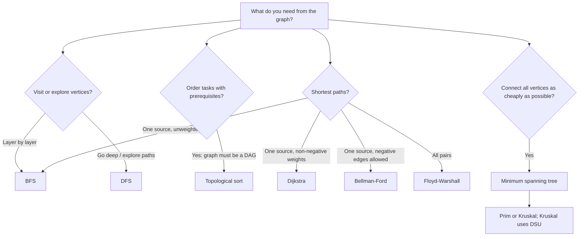

## Graph traversal

Traversal visits reachable vertices while tracking which ones have already
been seen. The implementations here start a traversal from every unvisited
vertex, so disconnected graphs are covered too. With adjacency lists, both
algorithms take `O(V + E)` time and `O(V)` auxiliary space.

### Breadth-first search (BFS)

BFS uses a queue: vertices are processed in nondecreasing order of their
number of edges from the start. Marking a vertex visited when it is enqueued
prevents duplicate queue entries.

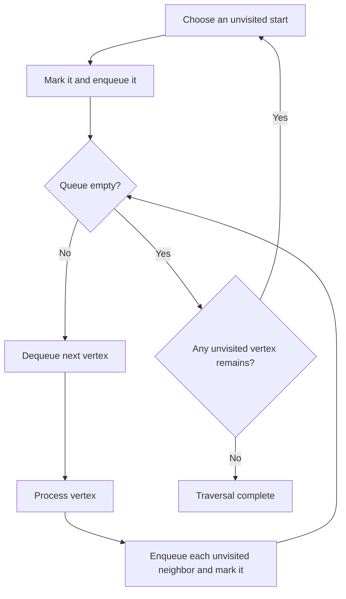

**Use BFS when** you need shortest paths by edge count in an unweighted graph,
the vertices at each distance from a source, or a level-order exploration.
For weighted edges, ordinary BFS does not in general find minimum-weight
paths.

- Implementation: [bfs.py](bfs.py)

### Depth-first search (DFS)

DFS follows one path as far as it can before backtracking. This implementation
uses an explicit stack rather than recursion, and pushes neighbors in reverse
adjacency order so that they are visited in the original order.

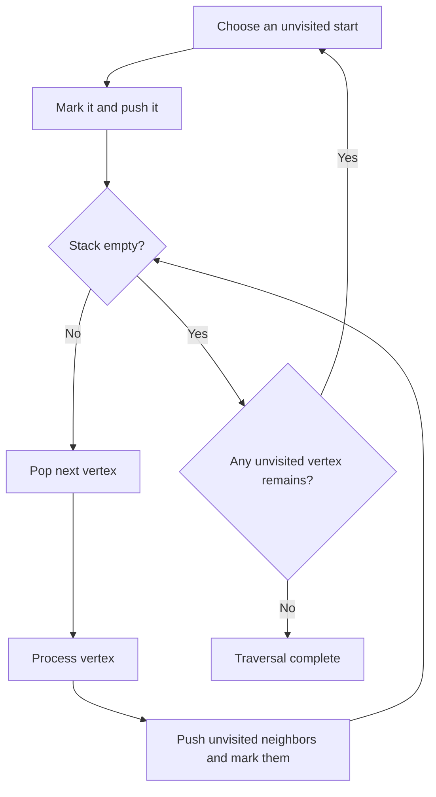

**Use DFS when** exploring components, checking reachability, detecting
cycles, or building algorithms based on entry/finish order. DFS traversal
order depends on the neighbor ordering; it is not a shortest-path algorithm.

- Implementation: [dfs.py](dfs.py)

## Topological sorting

A topological order is a linear ordering of a **directed acyclic graph (DAG)**
in which every edge `u -> v` places `u` before `v`. It is useful for task
scheduling, dependency resolution, and evaluating computations with
prerequisites. A cyclic graph has no such ordering.

Both implementations run in `O(V + E)` time and use `O(V)` auxiliary space.
They return an empty list when a cycle is detected.

### DFS finish-time method

The DFS implementation uses three states: unseen, active on the current
search path, and finished. An edge to an active vertex reveals a cycle. Each
vertex is appended when its descendants are finished; reversing that list
produces the topological order.

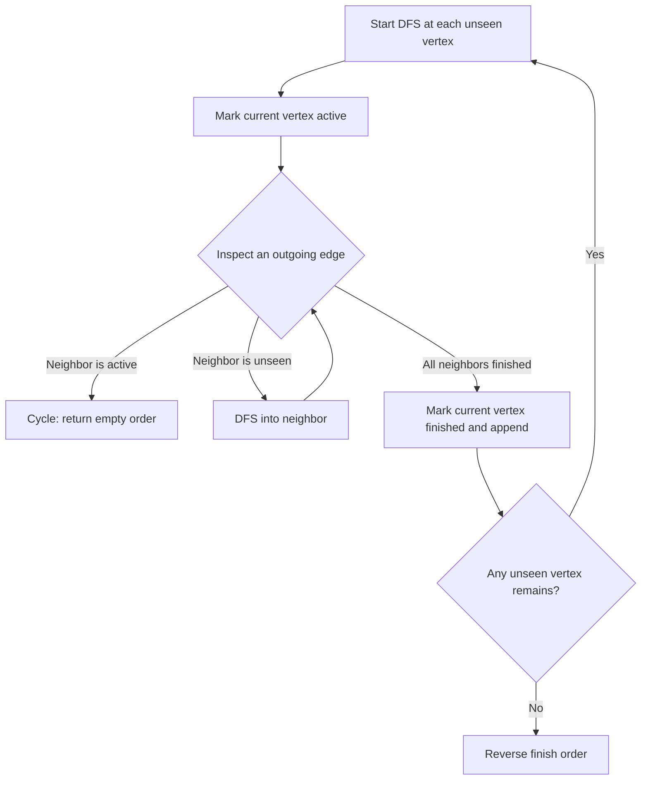

- Implementation: [toposort.py](toposort.py)

### Kahn's algorithm (indegree method)

Indegree is the number of incoming edges. Repeatedly remove a zero-indegree
vertex and decrement the indegree of its neighbors. If fewer than `V` vertices
are removed, the remaining vertices contain a cycle.

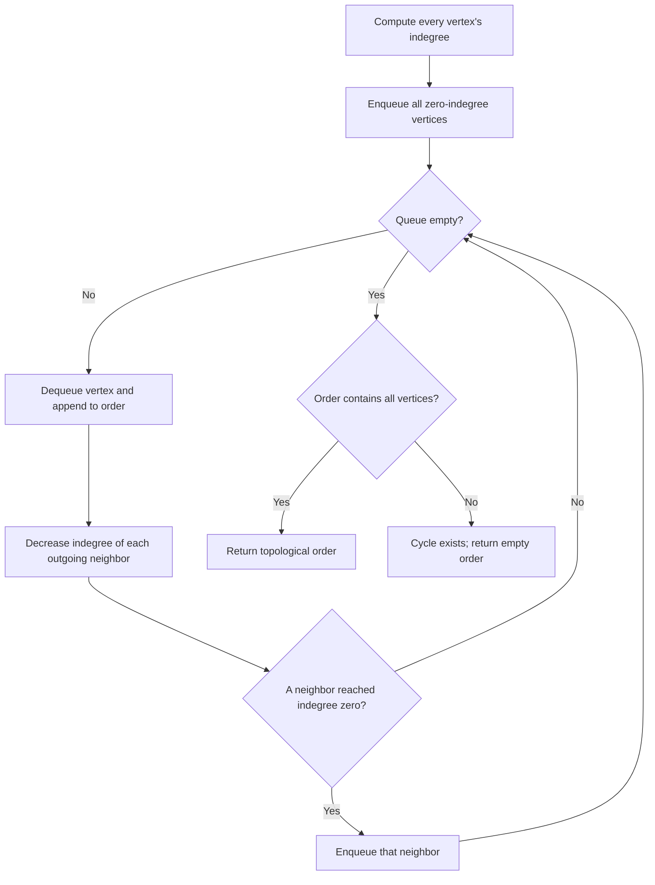

**Use this method** when the set of currently available tasks matters, such as
when constructing a schedule or processing prerequisite layers. Different
queue choices can produce different valid orders.

- Implementation: [topoSortBfs.py](topoSortBfs.py)

## Shortest paths

Shortest-path algorithms minimize total edge weight from one or more sources.
Choose based on edge weights and how many source/destination pairs you need;
negative edges are especially important because some algorithms cannot handle
them.

### Dijkstra's algorithm

Dijkstra repeatedly finalizes the unprocessed vertex with the smallest known
distance, then relaxes its outgoing edges. A min-heap efficiently selects
that vertex. The implementation ignores stale heap entries and rejects any
negative edge weight.

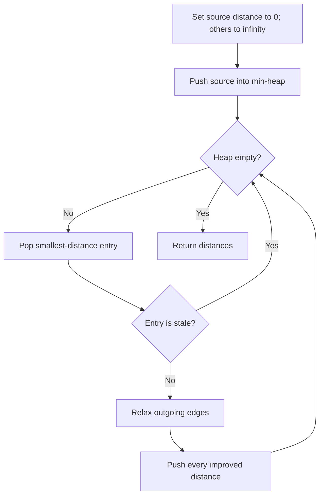

> Dijkstra requires non-negative edge weights. Rejecting negative weights
> avoids producing a plausible-looking but incorrect result.

**Use Dijkstra when** you need distances from one source and all edge weights
are non-negative. It runs in `O((V + E) log V)` with a binary heap and
adjacency lists. Unreachable vertices retain `float("inf")`.

- Implementation: [dijkstra.py](dijkstra.py)

### Bellman-Ford

Bellman-Ford relaxes every edge repeatedly. Any shortest simple path uses at
most `V - 1` edges, so `V - 1` passes suffice; a further possible improvement
indicates a reachable negative-weight cycle. Early stopping avoids unused
passes when no distance changed.

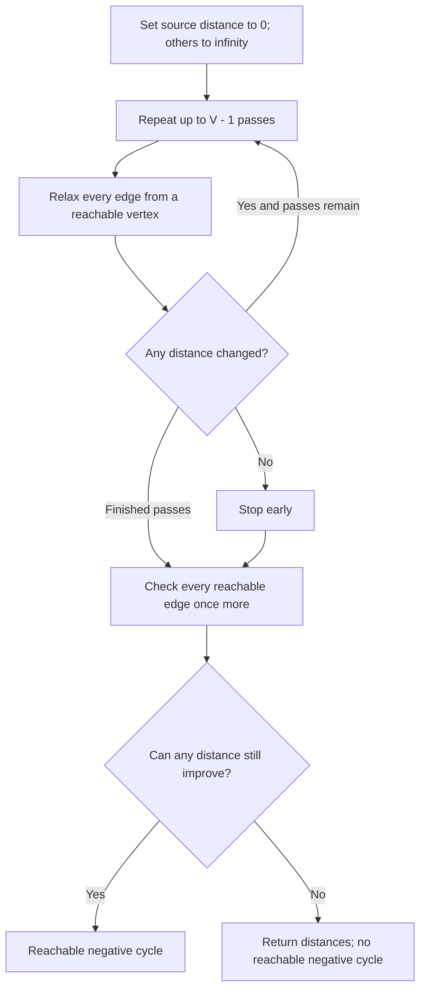

**Use Bellman-Ford when** edge weights may be negative or when you need to
detect a negative cycle reachable from the source. Its time cost is
`O(V * E)`, with `O(V)` auxiliary space. It returns `(distances, has_cycle)`;
unreachable vertices remain infinity, and unreachable negative cycles are not
reported.

- Implementation: [bellmanFord.py](bellmanFord.py)

### Floyd-Warshall

Floyd-Warshall computes distances for every source/destination pair by
considering each vertex in turn as a possible intermediate stop. For each
pair, it compares the current route with the route through that intermediate.
It updates the supplied matrix in place.

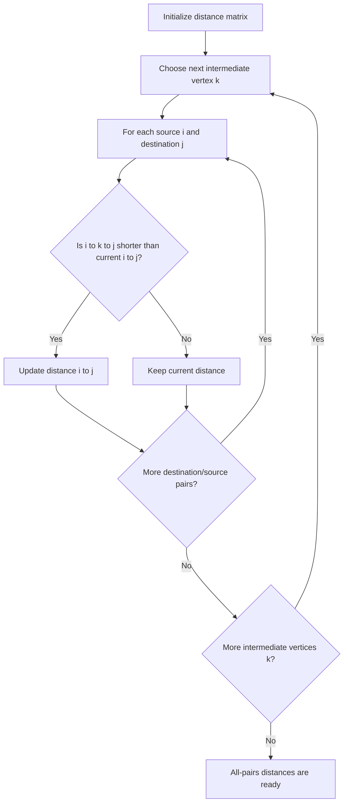

**Use Floyd-Warshall when** you need all-pairs shortest paths and the graph is
small or dense enough for `O(V^3)` time and `O(1)` extra space beyond the
`V x V` matrix. It supports negative edges, but shortest paths are undefined
when a negative cycle exists. After running, a negative diagonal entry
indicates such a cycle.

Initialize missing edges to `float("inf")` and each diagonal entry to `0`.

- Implementation: [floydWarshalll.py](floydWarshalll.py)

## Minimum spanning trees

A minimum spanning tree (MST) is a minimum-total-weight subset of edges that
connects every vertex of a connected, undirected, weighted graph without
cycles. It contains `V - 1` edges. Unlike a shortest-path tree, an MST
minimizes the total weight of the selected edges, not the distance from one
chosen source to each vertex.

If the graph is disconnected, no spanning tree exists; the implementations
raise `ValueError`. For `V = 0`, they return weight `0` and no edges.

### Prim's algorithm

Prim grows one tree. At each step it chooses the cheapest edge crossing from
the vertices already in the tree to a vertex outside it. A min-heap selects
that edge.

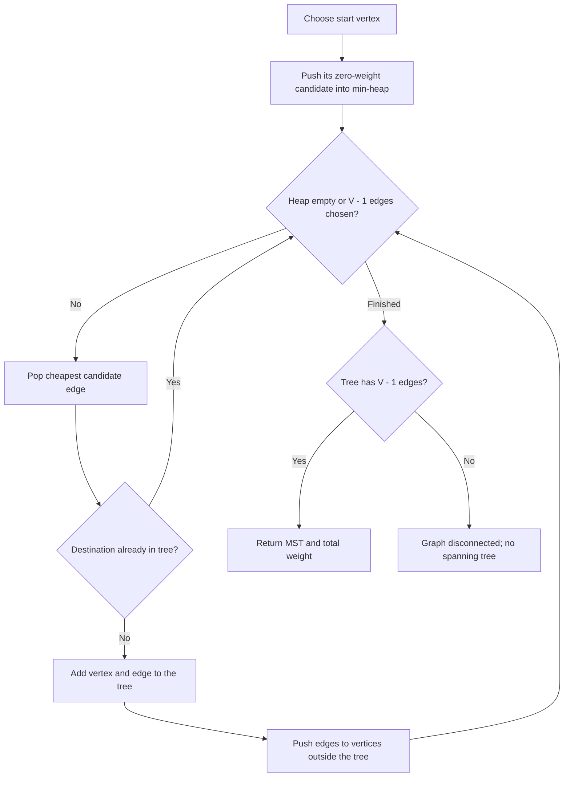

**Use Prim when** the graph is represented by adjacency lists and you want to
grow the spanning tree outward from a starting vertex. With a binary heap it
takes `O(E log V)` time for a simple graph.

### Kruskal's algorithm

Kruskal considers edges in ascending weight order and accepts an edge only
when it joins two different components. Sorting costs `O(E log E)`; the
component checks are nearly constant time amortized with DSU.

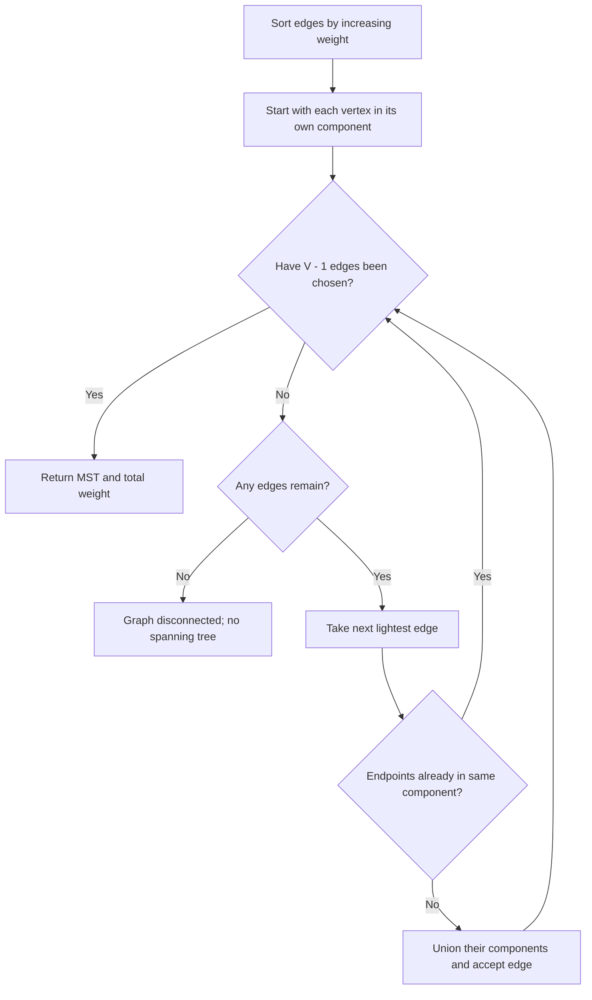

**Use Kruskal when** the edge list is readily available, or when you want a
straightforward edge-sorting approach. It also naturally identifies whether
the graph is disconnected by whether it can select `V - 1` edges.

- Implementations: [mst.py](mst.py)

### Disjoint Set Union (DSU)

DSU, also called Union-Find, maintains a partition of elements into disjoint
sets. `find` identifies a set's representative; `union` merges two sets and
returns whether a merge occurred. Path compression and union by size keep
operations near-constant amortized time, `O(alpha(V))`, where `alpha` is the
inverse Ackermann function.

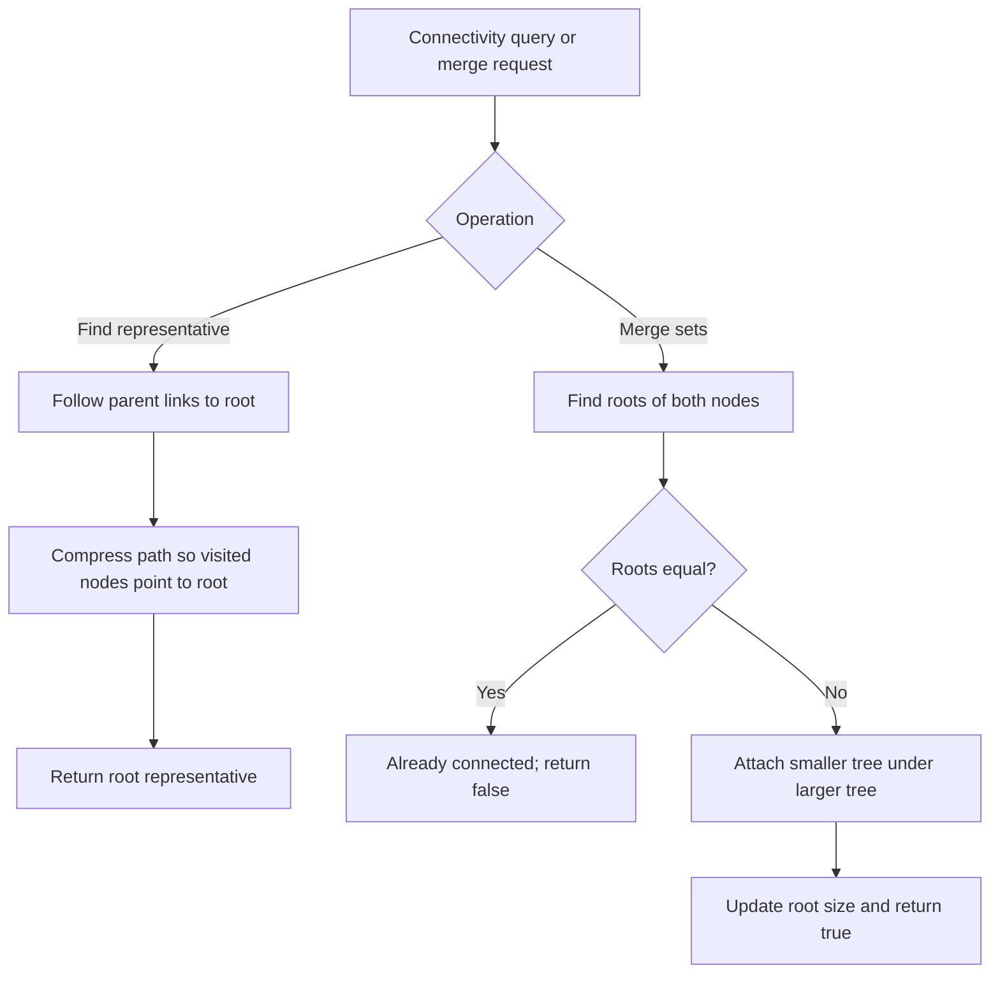

**Use DSU when** you need to track connectivity as edges are added, reject
cycle-forming edges in Kruskal's algorithm, or group elements by connected
component. It is designed for incremental unions, not for efficiently
removing edges.

- Implementation: [dsu.py](dsu.py)
